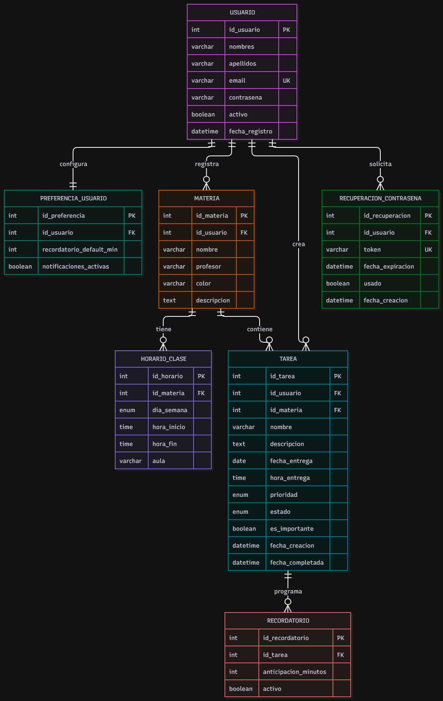

# EduTask — Sistema Web de Gestión de Tareas y Planificación Académica

Aplicación web para la organización de materias, horarios de clase, tareas y recordatorios académicos.

* **Sitio desplegado en línea:** [http://tuc4s.great-site.net/](http://tuc4s.great-site.net/)

## Tecnologías Utilizadas
* **Frontend:** HTML5, CSS3, JavaScript
* **Backend:** PHP 8+ (consultas preparadas `mysqli` y hashing seguro con `password_hash` / `password_verify`)
* **Base de Datos:** MySQL / MariaDB (`utf8mb4`)
* **Despliegue:** InfinityFree

## Estructura de la Base de Datos (`edutask`)

El modelo relacional está compuesto por **7 tablas** con integridad referencial (`ON DELETE CASCADE`):

1. **`usuario`**: Almacena los datos de acceso y perfil del estudiante (`contrasena` protegida mediante hash unidireccional).
2. **`preferencia_usuario`**: Configuración individual de notificaciones y tiempo de anticipación predeterminado (relación 1:1 con `usuario`).
3. **`recuperacion_contrasena`**: Gestión de tokens temporales de un solo uso (`token`, `fecha_expiracion`, `usado`) para el restablecimiento de contraseñas.
4. **`materia`**: Asignaturas registradas por cada usuario, con profesor, color identificador y descripción.
5. **`horario_clase`**: Bloques de día, hora de inicio/fin y aula asociados a cada materia.
6. **`tarea`**: Actividades académicas vinculadas al usuario y opcionalmente a una materia, con fecha/hora de entrega, prioridad y estado.
7. **`recordatorio`**: Alertas configuradas por tarea según el tiempo de anticipación (minutos, horas o días antes de la entrega).

### Diagrama Entidad-Relación

## Credenciales de Acceso (Usuario de Prueba)

Para probar el funcionamiento del sistema directamente en el sitio desplegado sin necesidad de realizar un registro previo, utiliza la siguiente cuenta precargada en la base de datos:

* **Correo electrónico:** `jesus@gmail.com`
* **Contraseña:** `12345`
