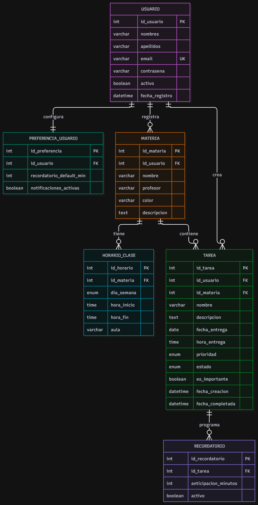

# EduTask — Sistema Web de Gestión de Tareas y Planificación Académica

Aplicación web diseñada para ayudar a estudiantes a organizar sus materias, horarios de clase, tareas pendientes, recordatorios y progreso académico en un solo lugar.

## Tecnologías Utilizadas
* **Frontend:** HTML5, CSS3, JavaScript
* **Backend:** PHP
* **Base de Datos:** MySQL (`utf8mb4_unicode_ci`)
* **Entorno Local:** XAMPP (Apache + MySQL)

---

## Modelo Entidad-Relación (MER)

El diseño de la base de datos contempla las entidades `usuario`, `preferencia_usuario`, `materia`, `horario_clase`, `tarea` y `recordatorio`.

---

## Instalación y Configuración Local

1. Clonar o descargar este repositorio dentro de la carpeta `htdocs` de XAMPP con el nombre `tareas` (`C:\xampp\htdocs\tareas`).
2. Iniciar los servicios de **Apache** y **MySQL** en el panel de control de XAMPP.
3. Abrir **MySQL Workbench** y conectarse al servidor local (`127.0.0.1` / `localhost`).
4. Abrir y ejecutar el archivo `Edutask.sql` para crear la base de datos, las tablas y el usuario de prueba.
5. Abrir el archivo `HTML proyecto programación web/Login/conexion.php` y verificar que los datos de conexión coincidan con tu servidor local (en XAMPP por defecto el usuario es `root` y la contraseña va vacía `""`).
6. Abrir el navegador e ingresar directamente al inicio de sesión en:  
   `http://localhost/tareas/HTML%20proyecto%20programaci%C3%B3n%20web/Login/Login.html`
7. Iniciar sesión con el usuario de prueba:
   * **Correo:** `jesus@gmail.com`
   * **Contraseña:** `12345`

---

## Módulos Principales del Sistema
* **Autenticación:** Inicio y cierre de sesión validado contra MySQL.
* **Dashboard:** Resumen general de actividades y próximos vencimientos.
* **Tareas y Recordatorios:** Gestión de entregas con prioridad, estado y alertas configurables.
* **Materias y Horarios:** Registro de asignaturas, profesores, colores identificadores y horarios de clase.
* **Calendario:** Visualización de entregas por semana y mes actual.
